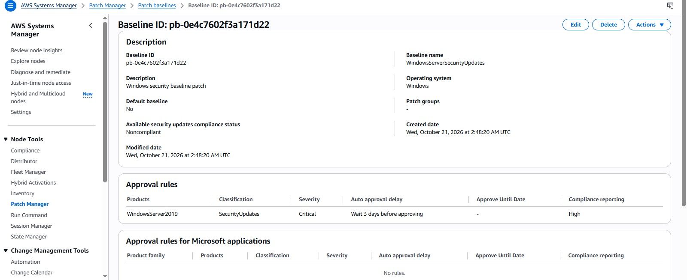
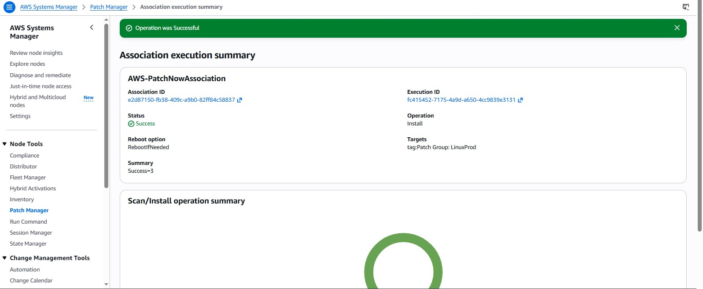
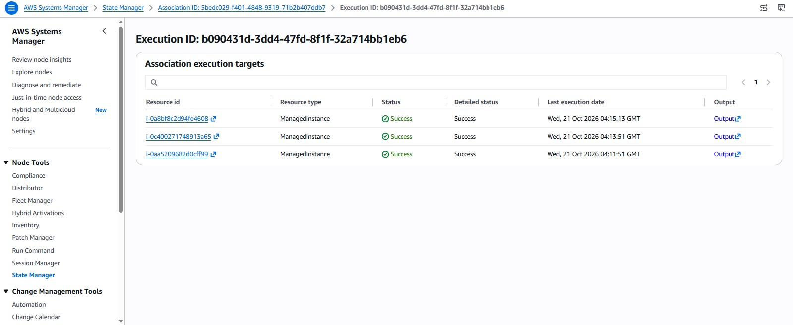
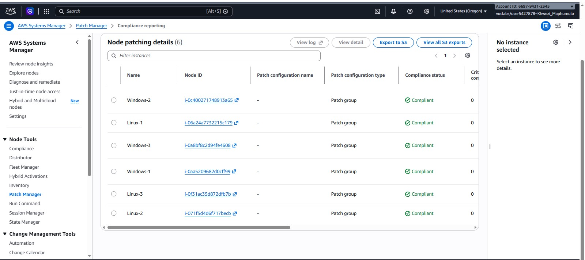

# Systems Hardening: Automated Patching with AWS Systems Manager

## 📖 Project Overview
In enterprise environments, manually logging into hundreds of servers to apply OS and application updates is inefficient, error-prone, and impossible to scale. 

This project demonstrates how to use **AWS Systems Manager (SSM) Patch Manager** to automate the patching lifecycle for a mixed-OS fleet (Linux and Windows). By leveraging EC2 tags and custom patch baselines, we establish a scalable, automated compliance strategy that reduces the attack surface without breaking production applications.

## 🏗️ Architecture & Strategy

The environment consists of 3 Linux instances and 3 Windows instances managed via the SSM Agent. 

*   **Linux Strategy:** Utilized the AWS-managed default patch baseline (`AWS-AmazonLinux2DefaultPatchBaseline`) as Linux security updates generally do not require the same level of cautious staging as Windows.
*   **Windows Strategy (The "Goldilocks" Rule):** Created a custom patch baseline (`WindowsServerSecurityUpdates`). We do not want *all* Windows updates (which could include untested feature updates that break legacy apps). We only auto-approve updates classified as `SecurityUpdates` with a Severity of `Critical` or `Important`.
*   **The 3-Day "Bake Time":** The custom baseline uses an auto-approval delay of 3 days. This ensures that Microsoft's newly released patches have time to be tested by the global community before being applied to our fleet, balancing security with stability.
*   **Tag-Based Targeting:** Instead of hardcoding Instance IDs, we used the tag `Patch Group: WindowsProd`. If an Auto Scaling group provisions a new Windows server tomorrow, it will automatically inherit this policy.

## 📸 Lab Evidence & Validation

### 1. Custom Windows Patch Baseline
Configuring the custom baseline to strictly target Windows Server 2019 Security Updates, separating Critical and Important severities with a 3-day auto-approval delay.

### 2. Linux Patching Execution
Applying the default baseline to the Linux fleet using tag-based targeting. All 3 nodes successfully patched.

### 3. Windows Patching Execution
Running the "Scan and Install" operation on the Windows fleet. The targets were successfully identified via tags, resulting in 3 successful patch executions.

### 4. Final Compliance Verification
After the patching cycles completed, the Compliance Reporting dashboard confirms that all 6 instances (3 Linux, 3 Windows) are now fully **Compliant** with 0 critical noncompliant patches remaining.

## 🚀 How to Replicate
1. Launch Linux and Windows EC2 instances and attach an IAM role with the `AmazonSSMManagedInstanceCore` policy.
2. In Systems Manager, navigate to Patch Manager and create a custom Patch Baseline for Windows (Target: WindowsServer2019, Severity: Critical/Important, Classification: SecurityUpdates).
3. Map the custom baseline to a patch group named `WindowsProd`.
4. Tag your EC2 instances with Key: `Patch Group` and Value: `WindowsProd`.
5. Initiate a "Patch now" operation in Patch Manager targeting the tag, with the operation set to "Scan and install" and reboot option set to "Reboot if needed".
6. Verify success via the Patch Manager Dashboard and Compliance Reporting tabs.

## 📚 Lessons Learned (Architect Takeaways)
- **Scale via Tags, not IDs:** Hardcoding resources is the enemy of automation. Tag-based targeting ensures new servers are automatically covered by security policies.
- **The "Bake Time" Concept:** Blindly applying zero-day patches is dangerous. A 3-day delay allows the vendor (Microsoft) to catch widespread bugs before they impact your production environment.
- **Continuous Compliance:** Security is not a one-time action. Automated patch reporting is critical for passing security audits and proving system hardening.
